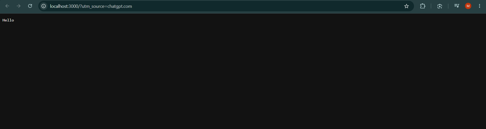
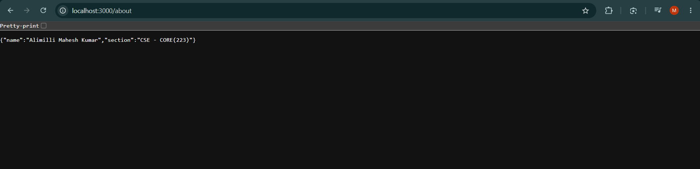
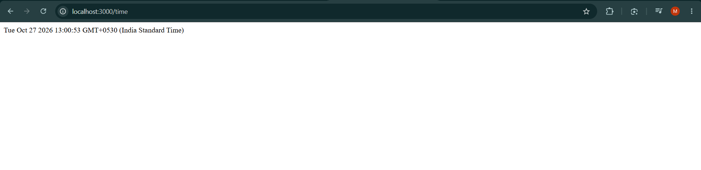
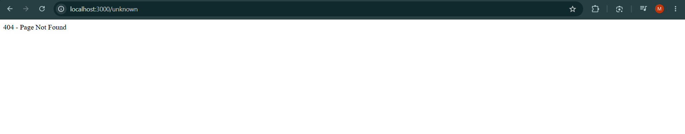
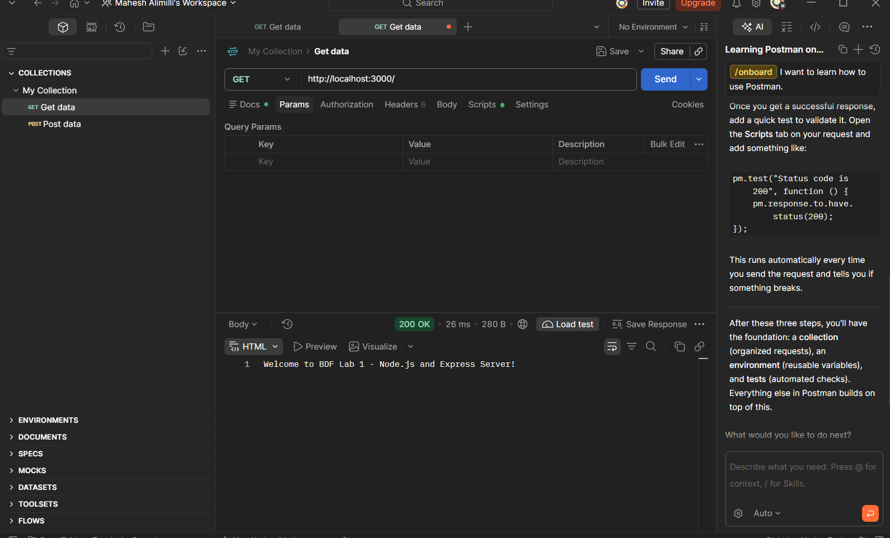
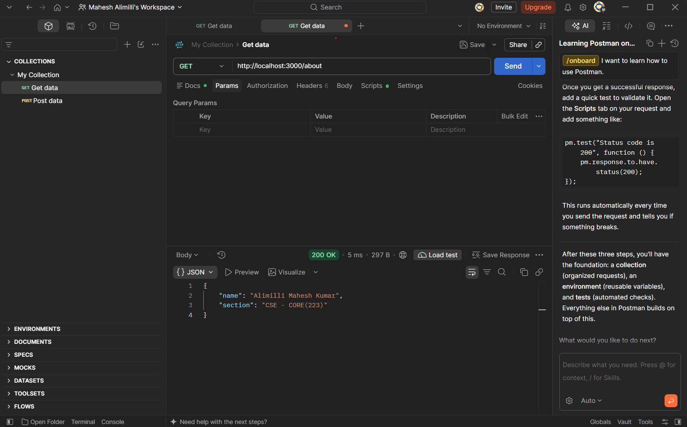
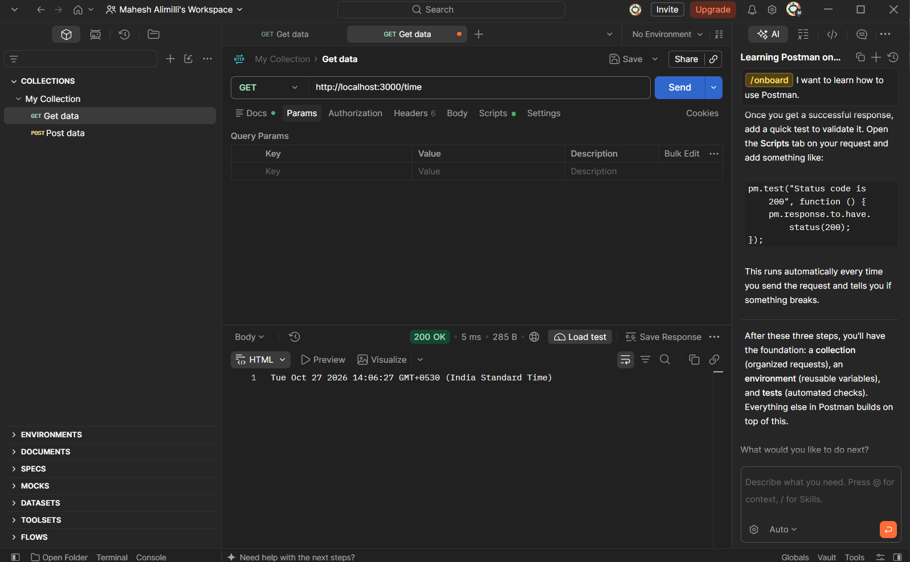
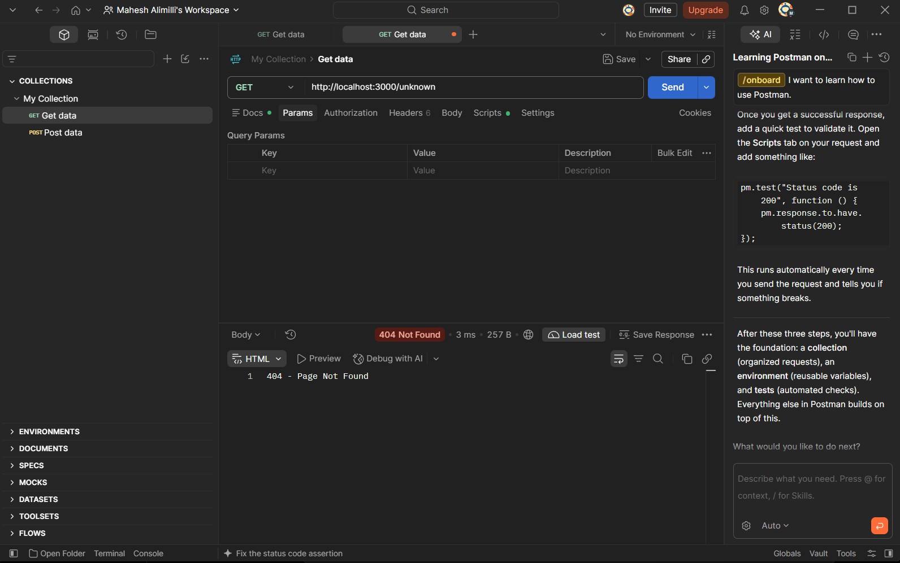

# BDF Lab 01 – Node.js and Express Server

**Student Name:** Alimilli Mahesh Kumar  
**Registration Number:** 252U1R1008
**Section:** CSE - CORE(223 & S15)
**Course:** Backend Development Fundamentals  
**Lab:** Lab 01 – Node.js and Express Server  
**Deployment URL:** **Deployment Note:** Public deployment could not be completed. The application was tested locally.

---

## 1. Introduction

This project is developed as part of the Backend Development Fundamentals course. It demonstrates how to create a basic HTTP server using Node.js and how to build a server with multiple API endpoints using Express.js.

The project includes a basic HTTP server, three Express GET routes, and a custom 404 response for unknown URLs.

## 2. Objectives

- Initialize a Node.js project using npm.
- Understand the purpose of `package.json`.
- Install Express.js.
- Create an HTTP server using Node.js.
- Build API routes using Express.js.
- Return text, JSON, and dynamic date/time responses.
- Handle invalid routes with HTTP status code 404.

## 3. Technologies Used

- Node.js
- Express.js
- JavaScript
- npm
- Visual Studio Code

## 4. Project Structure

```text
Alimilli-Mahesh-Kumar/
├── .gitignore
└── lab-01/
    ├── http-server.js
    ├── server.js
    ├── package.json
    ├── package-lock.json
    ├── README.md
    └── screenshots/
        ├── home.png
        ├── about.png
        ├── time.png
        └── not-found.png
```

**Note:** The `node_modules` folder is excluded from GitHub using `.gitignore`.

## 5. Installation

### Step 1: Clone the repository

```bash
git clone https://github.com/maheshallimili051624-art/Alimilli-Mahesh-Kumar.git
```

### Step 2: Open the lab folder

```bash
cd Alimilli-Mahesh-Kumar/lab-01
```

### Step 3: Install dependencies

```bash
npm install
```

## 6. Execution

### Run the Node.js HTTP Server

```bash
node http-server.js
```

Open http://localhost:3000 in a browser.

**Expected Output:**

```text
Hello
```

Stop the server using `Ctrl + C`.

### Run the Express Server

```bash
node server.js
```

The Express application runs at http://localhost:3000.

## 7. API Endpoints

| Method | Endpoint | Description | Status Code |
|---|---|---|---|
| GET | `/` | Displays a welcome message | 200 |
| GET | `/about` | Returns student details in JSON format | 200 |
| GET | `/time` | Returns the current date and time | 200 |
| GET | `/unknown` | Returns a page-not-found message | 404 |

## 8. Screenshots

### Home Endpoint



### About Endpoint



### Time Endpoint



### Unknown Route – 404



### Postman API Testing Screenshots

**GET / – Home (200 OK)**



**GET /about – About (200 OK)**



**GET /time – Time (200 OK)**



**GET /unknown – Not Found (404)**



## 9. Testing

The application was tested locally by opening each endpoint in a web browser.

The home route returned a welcome message, the about route returned JSON data, the time route displayed the current date and time, and the unknown route returned a 404 response.

## 10. Problems Faced and Solutions

**Problem 1:** Both the HTTP server and Express server use port 3000.

**Solution:** Stopped the running server using `Ctrl + C` before starting the next server.

**Problem 2:** Express requires dependencies to be installed.

**Solution:** Installed the required dependencies using `npm install`.

## 11. Notes

- The application was developed and tested locally using Node.js and VS Code.
- The project runs locally on port 3000.
- No environment variables are required for local execution.
- The `node_modules` directory and `.env` files are excluded from GitHub.
- Deployment is pending. Add the actual reason if public deployment cannot be completed.
- If deployment is unavailable, include Postman screenshots of all endpoints as required by the lab instructions.

## 12. Conclusion

This lab helped me understand how Node.js servers work and how Express.js simplifies backend development. I successfully created an HTTP server and implemented Express routes for text responses, JSON data, current date/time, and 404 error handling.