# BDF Lab 03 – REST API, Query Parameters and Validation

## 1. Student Details

- **Student Name:** Mahesh Kumar
- **Registration Number:** 252U1R1008
- **Section:** CSE - CORE(S15 & 223)
- **Course:** Backend Development Fundamentals
- **Lab Number:** Lab 03
- **Project:** Books REST API

## 2. Introduction

This lab focuses on developing a RESTful API using Node.js and Express.js.

The Books REST API provides functionalities to manage book records through CRUD operations. It also supports searching, sorting, pagination, and price filtering using query parameters.

Input validation and appropriate HTTP status codes are implemented to handle invalid requests and errors effectively. Postman is used to test the API endpoints and verify their responses.

## 3. Project Objectives

The main objectives of this lab are:

- To understand REST API architecture.
- To develop backend applications using Node.js and Express.js.
- To implement CRUD operations.
- To work with query parameters.
- To implement pagination, searching, sorting, and filtering.
- To perform input validation.
- To test API endpoints using Postman.

## 4. Technologies Used

| Technology | Purpose |
|---|---|
| Node.js | JavaScript runtime |
| Express.js | Backend framework |
| JavaScript | Programming language |
| SQLite | Database |
| Postman | API testing |
| Visual Studio Code | Code editor |
| Git and GitHub | Version control |

## 5. Project Structure

```text
Lab-03/
│
├── Screenshots/
│   ├── 01_GET_All_Books.png
│   ├── 02_GET_Pagination.png
│   ├── 03_GET_Price_Filter.png
│   ├── 04_GET_Search_Books.png
│   ├── 05_GET_Sorting.png
│   ├── 06_Invalid_Max_Price.png
│   ├── 07_Invalid_Min_Price.png
│   ├── 08_Invalid_Price_Range.png
│   ├── 09_POST_Create_Book.png
│   ├── 10_POST_Validation_Error.png
│   ├── 11_PUT_Update_Book.png
│   ├── 12_DELETE_Book.png
│   └── 13_DELETE_Not_Found.png
│
├── postman/
│   └── BDF_Lab_03.postman_collection.json
│
├── node_modules/
├── database.js
├── library.db
├── package.json
├── package-lock.json
├── routes.js
├── server.js
└── README.md
```

Note: The `node_modules` folder should be excluded from GitHub using `.gitignore`.

## 6. Installation and Execution

### Step 1: Clone the Repository

```bash
git clone https://github.com/maheshallimili051624-art/Alimilli-Mahesh-Kumar
```

### Step 2: Navigate to Lab 03

```bash
cd Alimilli-Mahesh-Kumar---BDF/lab-03
```

### Step 3: Install Dependencies

```bash
npm install
```

### Step 4: Start the Server

```bash
npm run dev
```

The local development server runs at:

```text
http://localhost:3000
```

## 7. API Testing Using Postman

A total of 13 API test cases were performed to verify the functionality of the Books REST API.

| No. | API Test Case | Method |
|---|---|---|
| 01 | Get All Books | GET |
| 02 | Get Books with Pagination | GET |
| 03 | Filter Books by Price | GET |
| 04 | Search Books | GET |
| 05 | Sort Books | GET |
| 06 | Invalid Maximum Price | GET |
| 07 | Invalid Minimum Price | GET |
| 08 | Invalid Price Range | GET |
| 09 | Create a New Book | POST |
| 10 | POST Validation Error | POST |
| 11 | Update an Existing Book | PUT |
| 12 | Delete a Book | DELETE |
| 13 | Delete Non-Existing Book | DELETE |

## 8. Postman Screenshots

### 8.1 GET – All Books

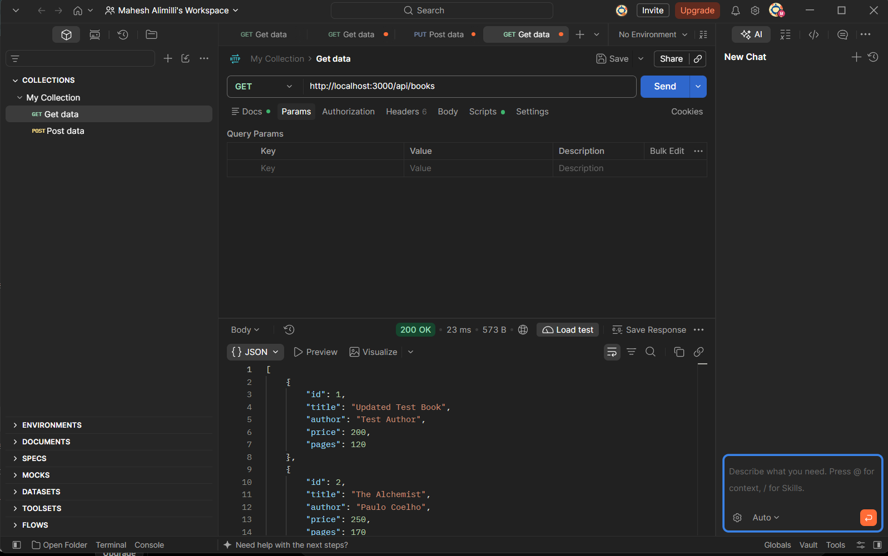

### 8.2 GET – Pagination

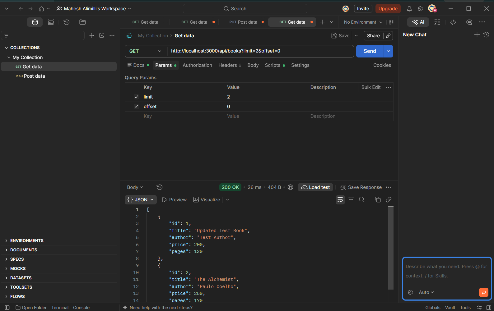

### 8.3 GET – Price Filter

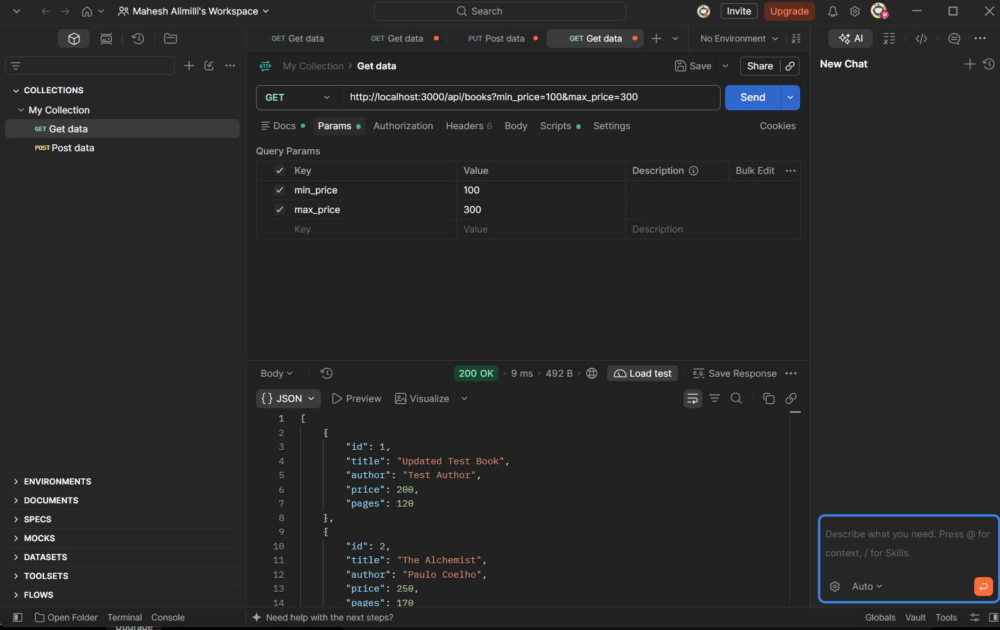

### 8.4 GET – Search Books

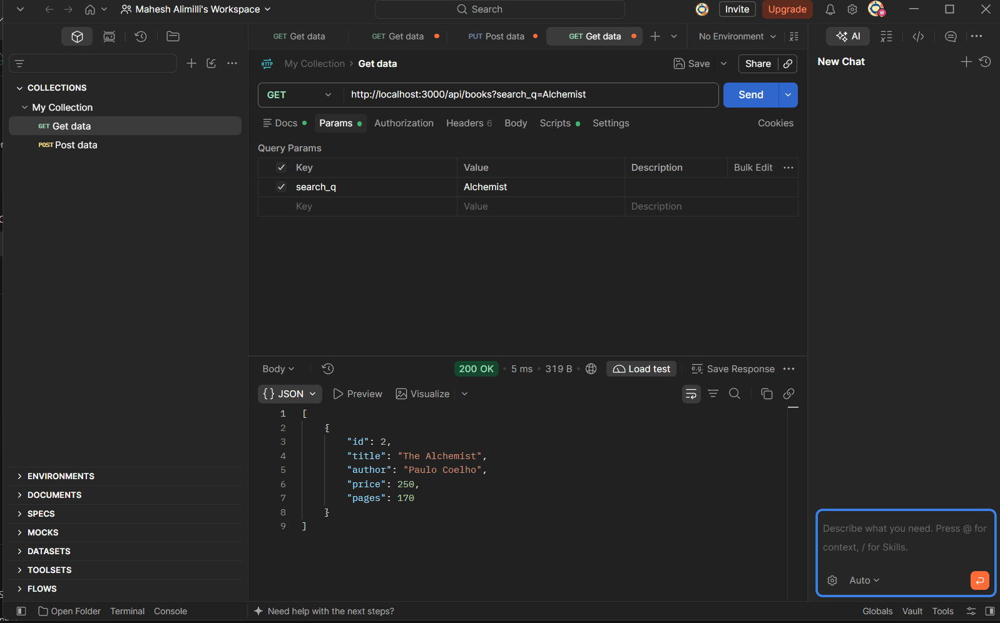

### 8.5 GET – Sorting

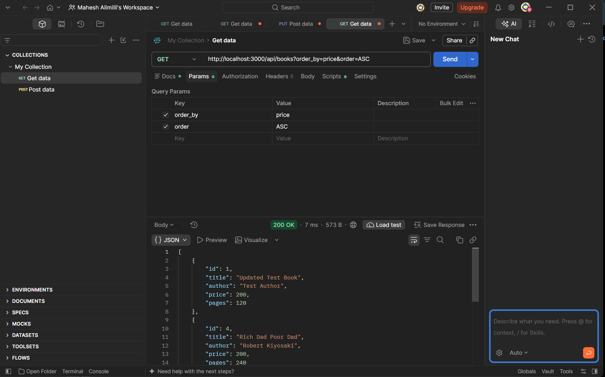

### 8.6 Invalid Maximum Price

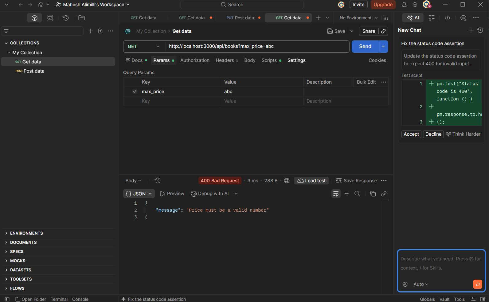

### 8.7 Invalid Minimum Price

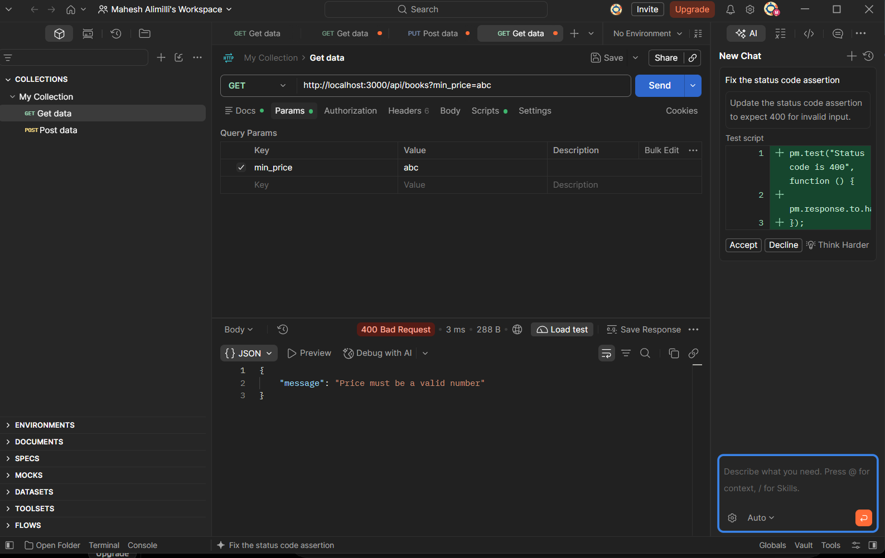

### 8.8 Invalid Price Range

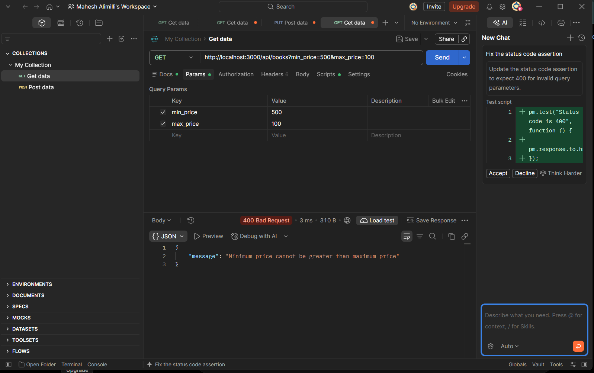

### 8.9 POST – Create Book

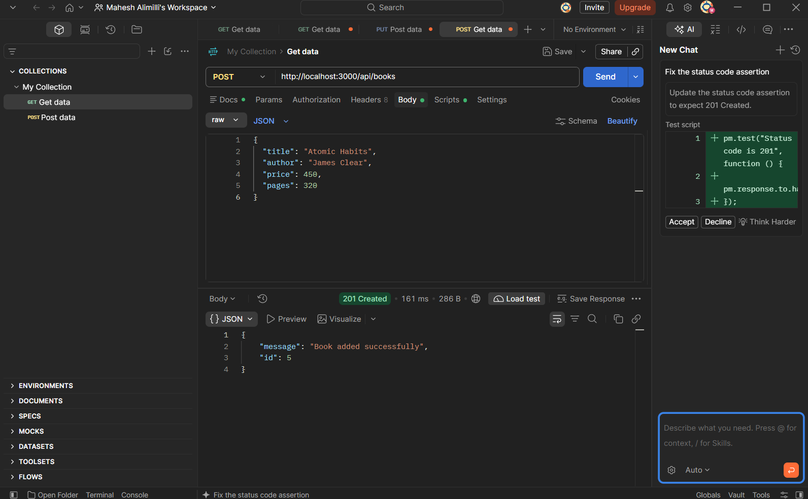

### 8.10 POST – Validation Error

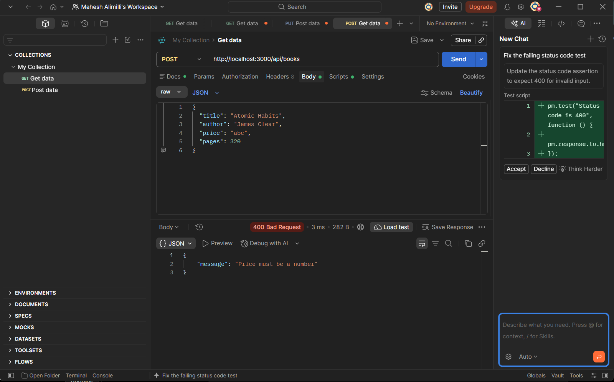

### 8.11 PUT – Update Book

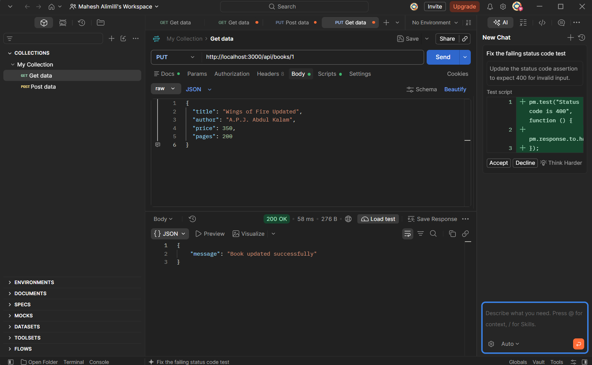

### 8.12 DELETE – Delete Book

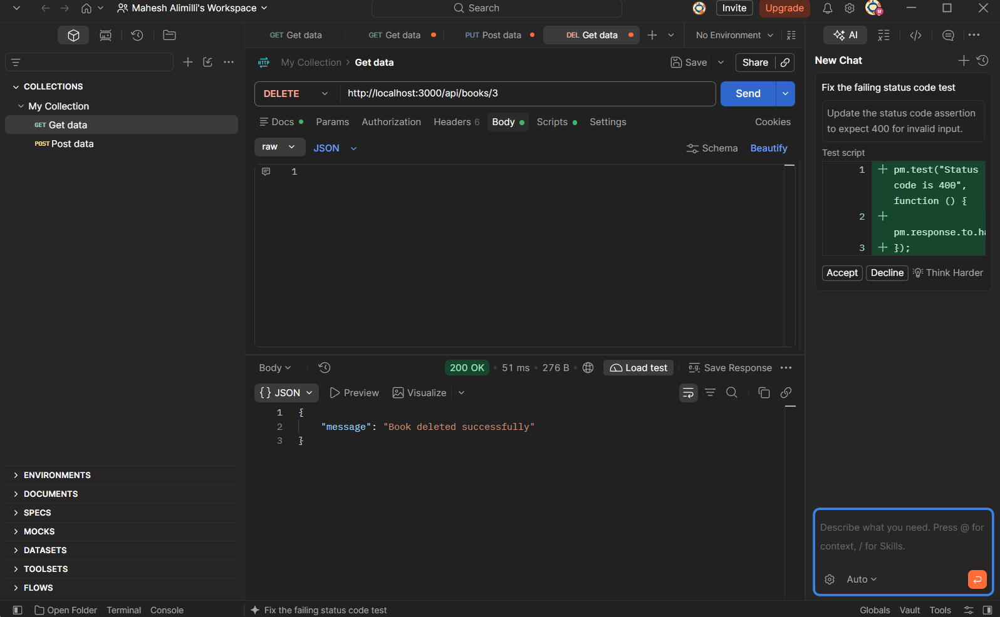

### 8.13 DELETE – Book Not Found

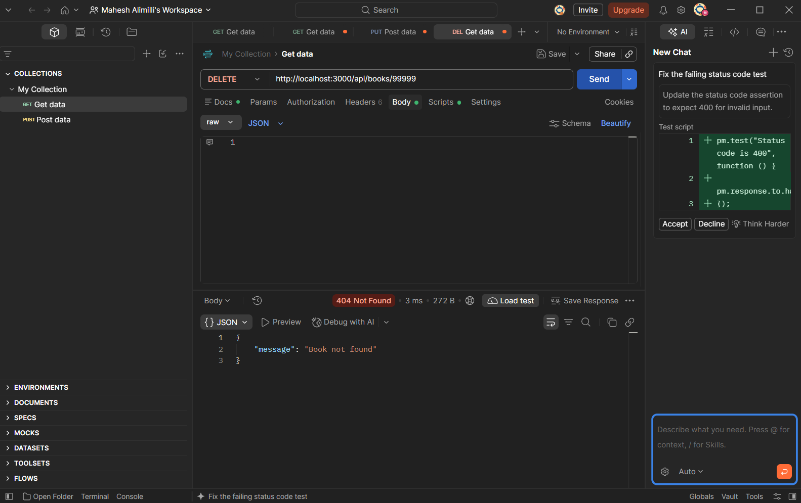

## 9. Postman Collection

The Postman collection containing all 13 API requests is available in the `postman/` directory.

The collection can be imported into Postman to execute and verify the API endpoints.

**Collection File:** `BDF_Lab_03.postman_collection.json`

## 10. Learning Outcomes

Through this lab, I gained practical knowledge of:

- REST API development using Node.js and Express.js.
- Implementing CRUD operations.
- Working with HTTP methods and status codes.
- Handling query parameters.
- Implementing pagination and sorting.
- Searching and filtering records.
- Performing input validation.
- Handling invalid requests and errors.
- Testing API endpoints using Postman.
- Working with SQLite databases.

## 11. Conclusion

This lab provided practical experience in developing RESTful APIs using Node.js and Express.js.

I implemented book management operations, query parameter handling, pagination, sorting, searching, price filtering, and input validation.

Testing all 13 API scenarios using Postman helped me understand API functionality, error handling, and backend development concepts.

Overall, this lab improved my practical understanding of REST API development and backend application design.

## 12. GitHub Repository

**Repository:** [Alimilli-Mahesh-Kumar---BDF](https://github.com/maheshallimili051624-art/Alimilli-Mahesh-Kumar---BDF)
